<div align="center">


# Work Time Tracker

**A local-first call, earnings and workflow tracker built for interpreters.**

Run live calls, track rates and goals, understand your patterns, manage work sessions and payment cycles, and use interpreter support tools. All in one workspace, with no account and no cloud sync.


**[Open the live demo](https://untopo.github.io/work-time-tracker/)** &nbsp;·&nbsp; **[Download for Windows and Android](https://github.com/untopo/work-time-tracker/releases/latest)** &nbsp;·&nbsp; **[Join the Discord](https://discord.gg/eRayqAkFWC)**

<br>

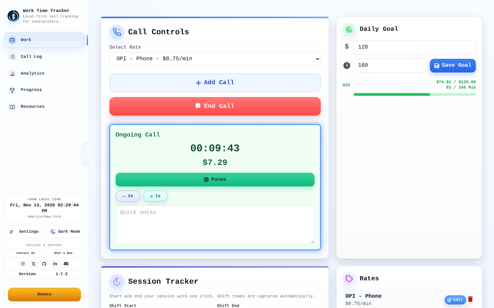

</div>

Your call records and work history stay on your device. A few optional web features send limited information only when you choose to use or enable them; see [Data and Privacy](#data-and-privacy).

---

## Contents

- [At a glance](#at-a-glance)
- [Take a tour](#take-a-tour)
- [Why it exists](#why-it-exists)
- [Core features](#core-features)
- [Data and privacy](#data-and-privacy)
- [Backup and restore](#backup-and-restore)
- [Onboarding](#onboarding)
- [Platforms and downloads](#platforms-and-downloads)
- [Quick start](#quick-start)
- [Build commands](#build-commands)
- [Tech stack](#tech-stack)
- [Architecture](#architecture)
- [Project structure](#project-structure)
- [FAQ](#faq)
- [Limitations](#limitations)
- [Browser support](#browser-support)
- [Contributing](#contributing)
- [Releases](#releases)
- [Community](#community)
- [Support the project](#support-the-project)
- [Feedback](#feedback)

---

## At a glance

| | |
|---|---|
| **Track** | Live calls with a real-time timer and earnings, manual calls, multiple rates, daily goals in USD and minutes |
| **Organize** | Work sessions with pauses and utilization, optional session automation, payment cycles (also per rate) |
| **Understand** | Analytics for calls and for time, a monthly report, patterns by hour, week and month, progress and streaks |
| **Stay safe** | No account, no WTT cloud, JSON backups you control, reminders when calls only live on one device |
| **Run anywhere** | Web app, Windows desktop app (Tauri) and Android app (Capacitor) from one shared codebase |

---

## Take a tour

### Work: your control room

Start a call and watch the timer and earnings update in real time. Rates, your daily goal and the session tracker live on the same screen, so everything you need during a live call is one glance away.

<table>
<tr>
<td width="50%">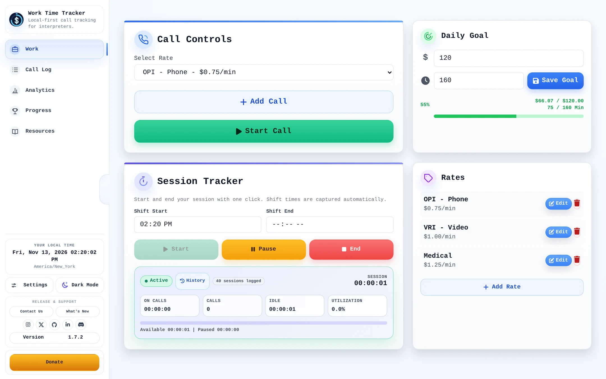</td>
<td width="50%">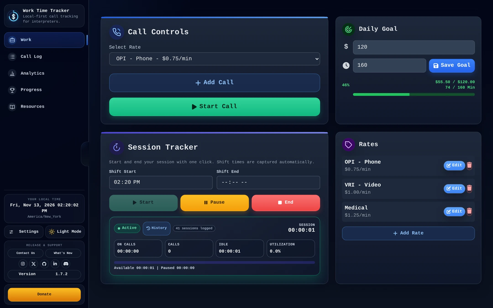</td>
</tr>
<tr>
<td align="center"><sub>Light theme</sub></td>
<td align="center"><sub>Dark theme</sub></td>
</tr>
</table>

- Start and end live calls with real-time timer and earnings, or log a manual call when it is already over
- Manage multiple billing rates and a daily goal in USD and minutes
- Run work sessions with pause and resume, and watch utilization as you go
- Optional **session automation** (off by default): your first live call starts the session, a new call resumes it, and the session pauses and ends by itself after the idle times you choose

When a call ends, a quick review strip lets you undo it, edit it or dismiss it before moving on.

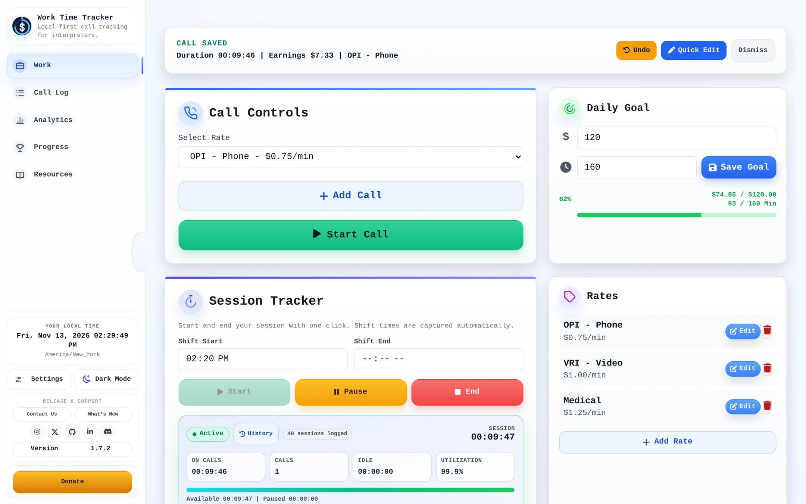

### Focus Mode: optional, one tap

During a live call, tap **Focus** to blur the workspace and center what matters: a big live timer, real-time earnings and a ring that fills as you approach your daily goal. Exit anytime, with the button or the Esc key, without touching the call. Prefer the classic view? Turn Focus Mode off in `Settings -> Features`.

<table>
<tr>
<td width="50%">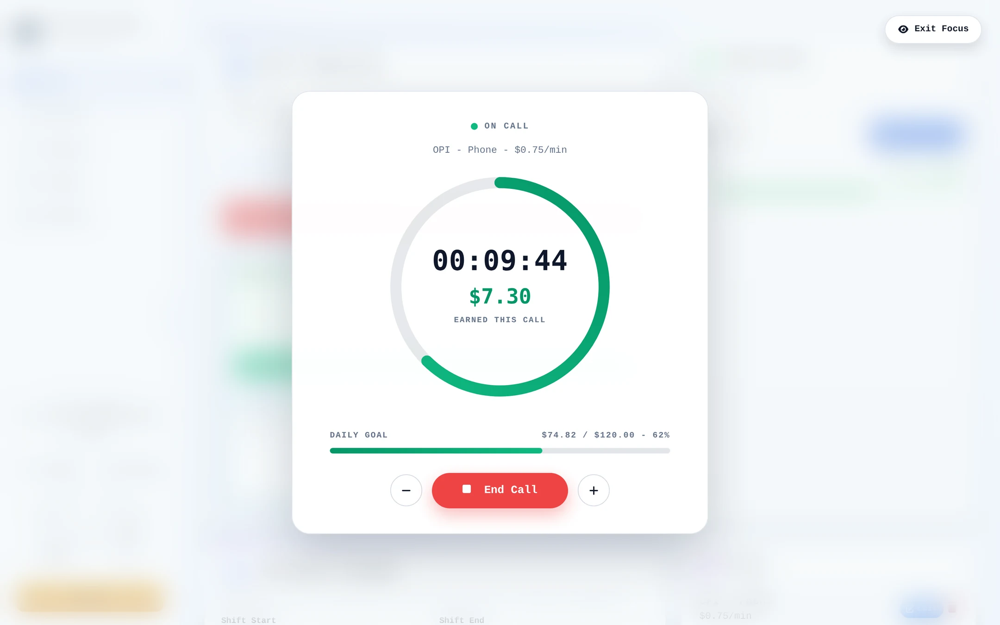</td>
<td width="50%">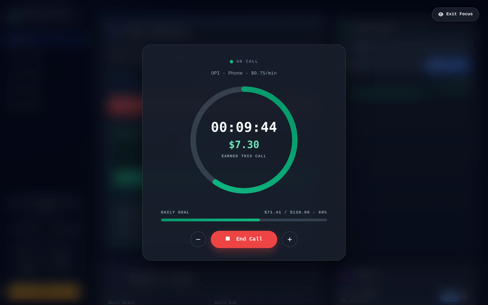</td>
</tr>
</table>

### Call Log: your history, calls and sessions

Every saved call in one place: filter by date range, search and edit entries. Import a company CSV history or export your own, with preview, column mapping and dedupe before anything is saved.

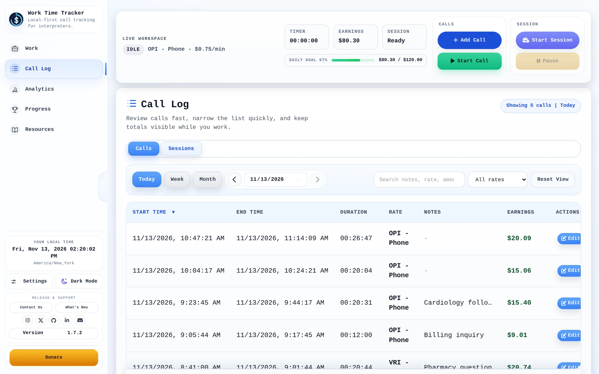

The **Sessions** tab keeps your completed work sessions next to your calls. A month calendar shades each day by how much of your time was spent talking, and every session has a Details view with who started and ended it (you or automation) and each pause.

<table>
<tr>
<td width="50%">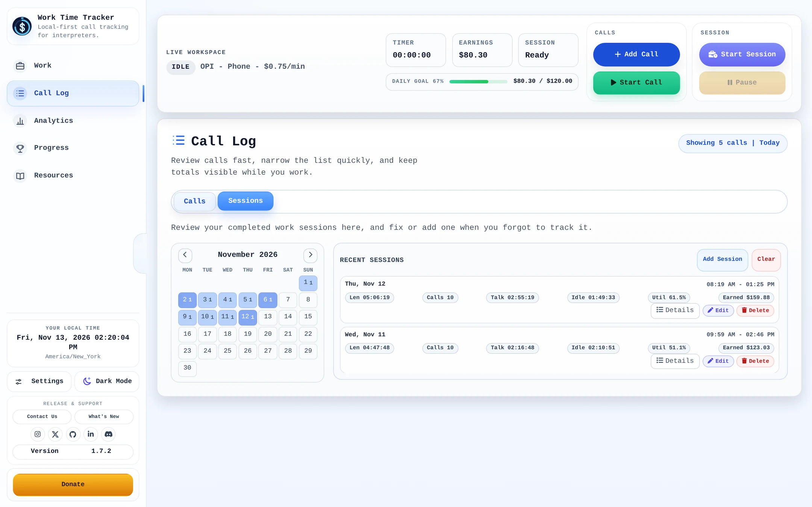</td>
<td width="50%">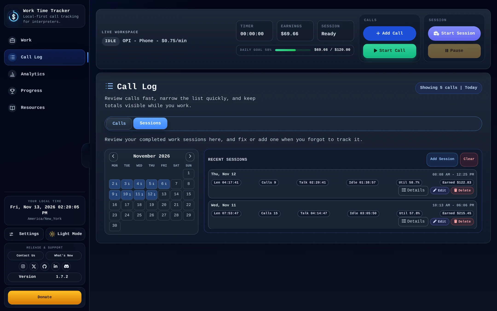</td>
</tr>
</table>

### Analytics: your patterns

The **Calls** tab covers daily earnings, average call duration, pace against yesterday and goal progress, plus hourly, weekly and monthly patterns. Payment-cycle snapshots show what you earned in the current cycle and when it pays.

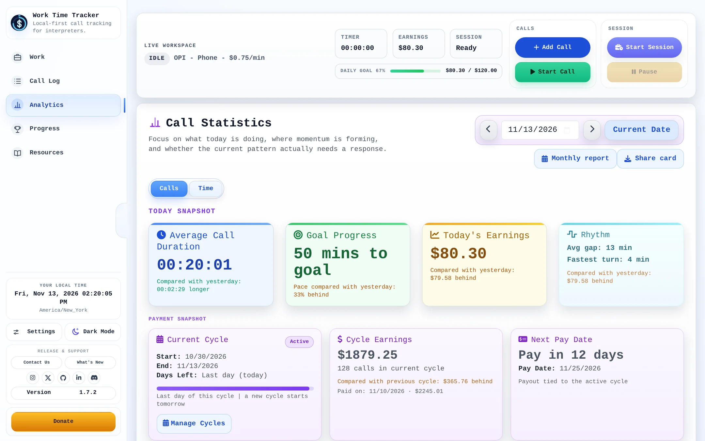

The **Time** tab looks at your work sessions of the last 30 days: sessions, average utilization, talk and idle time, average session length, earnings per available hour, pauses and utilization by weekday.

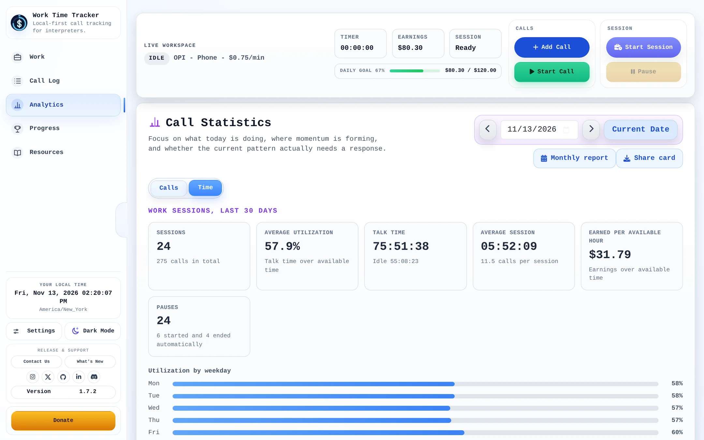

### Payment cycles, per rate

Paid on different schedules by different agencies? Give each payment cycle an **Applies to** rate and Analytics shows that rate's current cycle on its own card, with earnings, days left and pay date. Calls are never counted twice, and when every cycle belongs to a rate the main cycle cards step aside so only the rate cards remain.

Under each rate's previous cycle a small **Pay Day** line shows when that cycle is paid and how much that payday brings, which helps when you are paid in arrears. After the date passes it reads "Paid on".

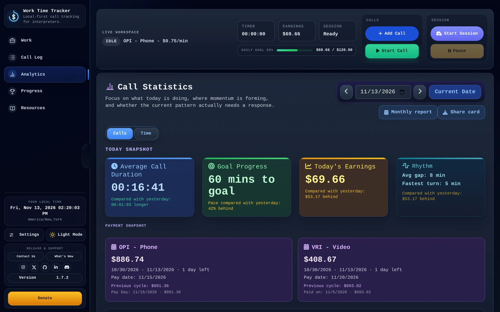

### Progress: your consistency

Progress has three tabs: **Today** (level, daily focus and Daily Quests), **Week** (Weekly Arc and Streak Shield) and **Achievements** (all-time milestones). It is stored locally, right next to the calls that earned it.

<table>
<tr>
<td width="50%">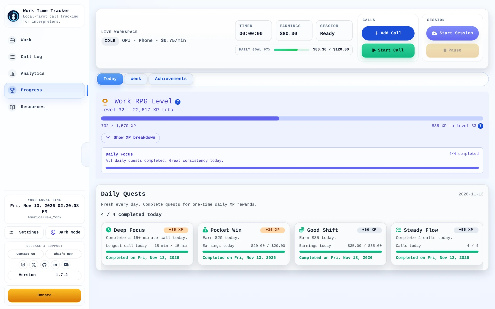</td>
<td width="50%">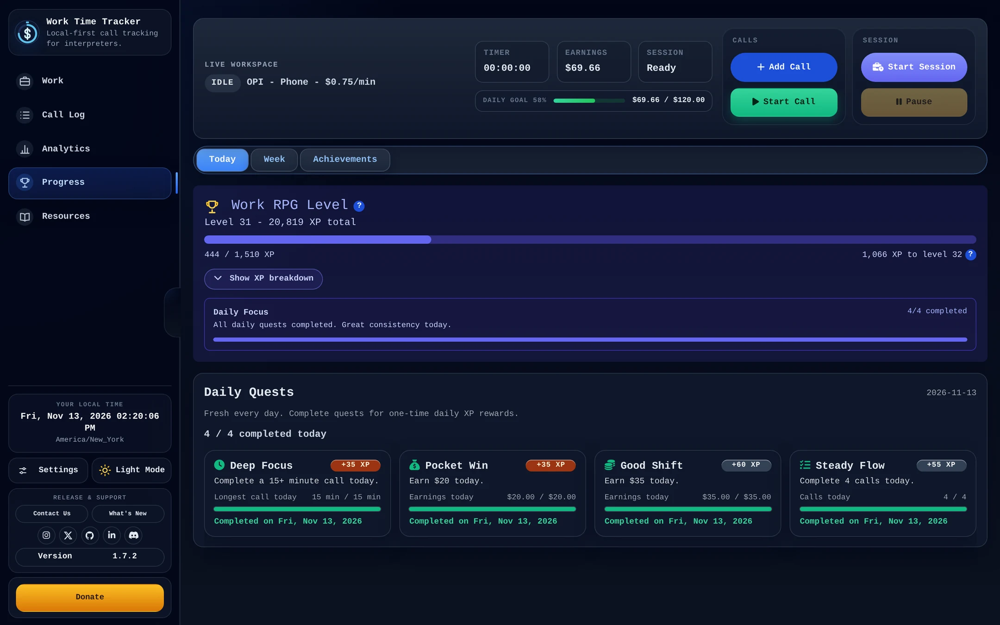</td>
</tr>
</table>

### Resources: your support tools

Two interpreter support tools built into the workspace:

- **US ZIP / Address Lookup**: one-bar search for ZIPs, cities, states and partial addresses, with ranked matches and recent lookups
- **Interpreter Language Assistant**: multilingual term lookup with ranked translation candidates, related terms and frequent searches

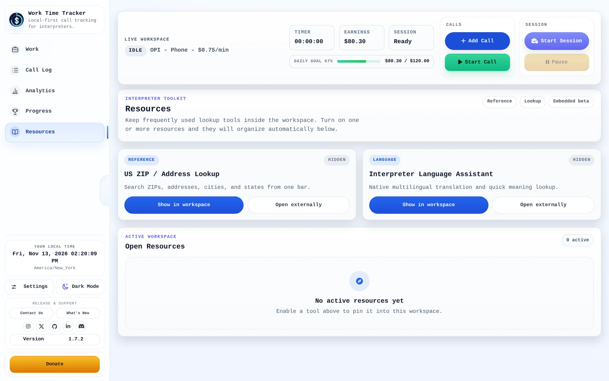

### On mobile

Responsive layouts for desktop, tablet and mobile, including floating call controls so you can start and end calls without losing your place.

<table>
<tr>
<td width="50%" align="center">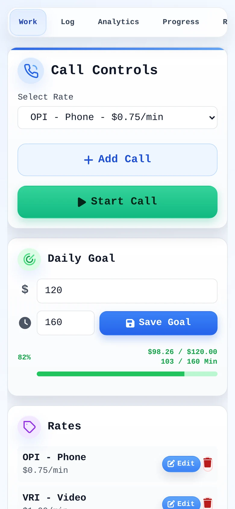</td>
<td width="50%" align="center">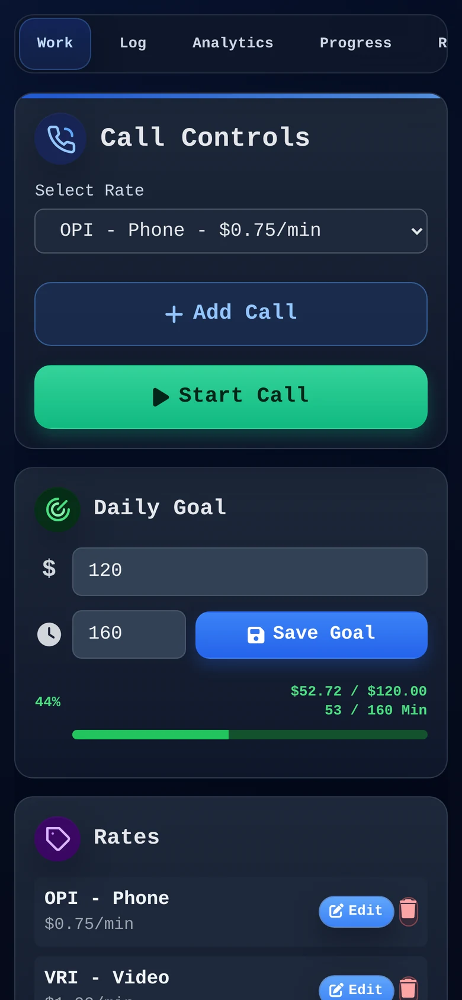</td>
</tr>
</table>

<sub>Screenshots use demo data generated for this page. No real call records are shown.</sub>

---

## Why it exists

- Track paid calls and earnings without spreadsheets
- Keep work data local and simple
- Stay fast during live interpreting work
- Combine tracking and support tools in one workspace

It is built for interpreters who bill by duration, freelancers tracking time-based income, and anyone who wants a private tool with no account setup.

## Core features

| Area | What you get |
|---|---|
| **Calls** | Live call timer with real-time earnings, manual call entry and editing, quick post-call review with undo, optional notes |
| **Rates and goals** | Multiple billing rates, daily goal in USD and minutes with live progress |
| **Sessions** | Session tracker with pause and resume, utilization metrics, optional automation, session history with a month calendar |
| **Focus** | Optional Focus Mode and floating call controls for live calls |
| **Call Log** | Date filters, search, CSV import with preview, column mapping and dedupe, CSV export |
| **Analytics** | Calls and Time views, hourly, weekly and monthly patterns, monthly report, shareable card |
| **Payments** | Payment cycles with pay dates, separate cycles per rate, Pay Day line for the previous cycle, cycle generator |
| **Progress** | Level, XP, Daily Quests, Weekly Arc, Streak Shield and achievements |
| **Data safety** | JSON backup export and import, last-backup date, backup reminders, duplicate-safe imports |
| **Experience** | Light and dark themes, a consistent icon and button style, in-app changelog, responsive layouts |

## Data and Privacy

WTT is local-first. It does not require an account, does not run a WTT cloud account or cloud database, and does not automatically sync your work records to a server.

- Call records, rates, goals, sessions, payment cycles, settings, and progress are stored locally on the device/browser profile where you use the app
- Backups move your saved WTT records only when you explicitly export or import a file
- Temporary live-call notes are not persisted or included in backups
- Local storage is not the same as a backup: clearing browser/site data, uninstalling the app, losing the device, or storage corruption can still cause data loss

### What Leaves Your Device

The core work log is not uploaded. A small number of optional features connect to external services, and each sends only the information needed for that feature:

| Feature | Destination | What is sent | How to avoid it |
|---|---|---|---|
| Usage analytics (web only, opt-in) | GoatCounter (`gc.zgo.at`) | Fixed event names and coarse buckets for usage (such as a call-duration range, daily call-count range, daily hours range, feature toggles, and selected UI actions). No call rows, exact earnings, rates, notes, or timestamps are included in these events | Turn off `Settings -> Features -> Share anonymous usage counts` |
| Update check | `untopo.github.io`, `api.github.com` | Requests the public version/release information so the app can check for updates; no call log or work records are included | Ignore the update notice; the request itself is part of checking for updates |
| US ZIP / Address Lookup | `api.zippopotam.us`, `nominatim.openstreetmap.org` | The ZIP code, city, or address you enter | Do not use this tool, or avoid entering sensitive/private addresses |
| Interpreter Language Assistant | `api.mymemory.translated.net`, `api.dictionaryapi.dev`, `api.datamuse.com` | The term you search for | Do not use this tool for confidential terms or patient-related information |
| Contact Us form | `formspree.io` | The message and any contact details you choose to provide | Do not include patient information or confidential work details; use the published project email instead |
| Optional sync survey | Project survey endpoint | Anonymous choice counts; a written comment is sent only if you choose to write one | Skip the survey or leave the comment field blank |

Styles and icons are self-hosted. The web app does not need a third-party font or icon CDN to render.

If you work under medical, legal, or other confidentiality rules, do not enter patient-identifying information, case details, or confidential interpreting content into Resources searches, the contact form, or the optional survey comment. Those are separate services and are not part of the local call log.

### Analytics details

The web version can send optional usage events only when `Share anonymous usage counts` is enabled. It sends fixed event labels and coarse ranges rather than individual call records. Depending on the enabled features, events can include call started/ended, Focus Mode, reminder choices, report/card usage, and broad daily totals. The app does not attach your name, email, rates, notes, exact earnings, or call history to these analytics events. As with any web request, the analytics provider may process ordinary connection metadata under its own privacy policy.

- The setting is available in `Settings -> Features -> Share anonymous usage counts`
- Turning it off prevents WTT from sending these optional usage events
- Desktop (Tauri) and Android (Capacitor) builds skip this analytics feature
- The app's local work records are not changed by enabling or disabling analytics
- Self-hosted copies can remove the analytics integration from `assets/js/app.js`

## Backup and Restore

Open `Settings -> My data` and use `Export Backup JSON` to create a full backup file. Keep a copy somewhere separate from the device you use for WTT (for example, an encrypted folder or an external drive).

- A JSON backup contains your saved app data, including call records, rates, goals, sessions, payment cycles, and progress
- `Export Call Log CSV` exports call rows only; it is useful for spreadsheets, but it is not a full restore backup
- Imports are previewed/reviewed before they are saved, and duplicate call entries are skipped in supported merge flows
- WTT shows the last full-backup date and reminds you when calls exist only in the current browser/device
- Exporting a backup is manual: WTT does not silently upload it to cloud storage
- A backup is only useful if you keep the file safe and can find it later. Periodically make a fresh export and verify that it exists in your backup location

**Recommended habit:** export a full JSON backup at the end of each workweek, and before clearing browser data, changing devices, reinstalling, or resetting the app. Keep at least one additional copy outside the device.

## Onboarding

New users see a first-run welcome guide with three paths: Quick Start, Customize First, or Skip. The guide tracks three practical milestones: saving a first rate, saving a first call, and opening Settings. Contextual cue cards then guide the user through adding a rate, trying a test call, and customizing the workspace. The guide can be restarted from Settings.

The fastest setup is: add one billing rate, run a short test call, then review Settings. A test call is just a setup check; delete it afterward if you do not want it in your work history.

## Platforms and downloads

One version of the app, three ways to run it:

| Platform | Technology | How to get it | Notes |
|---|---|---|---|
| Web | Static files | [Open the live demo](https://untopo.github.io/work-time-tracker/) | Runs from the project root; works on GitHub Pages |
| Windows | Tauri | `.exe` or `.msi` from [Releases](https://github.com/untopo/work-time-tracker/releases/latest) | Native file dialogs for import and export; no analytics |
| Android | Capacitor | `.apk` from [Releases](https://github.com/untopo/work-time-tracker/releases/latest) | Responsive mobile and tablet layouts; no analytics |

All three share the same frontend and release-version syncing.

## Quick Start

```bash
git clone https://github.com/untopo/work-time-tracker.git
cd work-time-tracker
```

Open `index.html` directly for the web version, or use the build commands below for packaged targets.

## Build Commands

### Web

```bash
npm run build:web
```

### Desktop

```bash
npm run tauri:dev
npm run tauri:build
```

### Android

```bash
npm run cap:sync
npm run cap:sync:android
npm run cap:open:android
```

To produce a signed Android release, copy `android/keystore.properties.example` to `android/keystore.properties` and fill in your keystore values, or provide the same values through these environment variables:

- `WTT_ANDROID_KEYSTORE_FILE`
- `WTT_ANDROID_KEYSTORE_PASSWORD`
- `WTT_ANDROID_KEY_ALIAS`
- `WTT_ANDROID_KEY_PASSWORD`

Then build from Android Studio or run:

```bash
cd android
gradlew assembleRelease
```

### Tests and checks

```bash
npm run test:unit
npm run test:e2e
npm run verify:version-sync
npm run verify:release-ready
```

## Tech Stack

- Vanilla JavaScript
- HTML and CSS
- Tauri for desktop packaging
- Capacitor for Android packaging

## Architecture

WTT uses a shared frontend across web, desktop, and Android. The application is still a plain-script JavaScript app rather than a fully bundled ES-module application. `app.js` remains the central coordinator for UI state, DOM events, navigation, and feature wiring; domain logic that can run independently has been progressively extracted into smaller files and covered by unit tests.

Current boundaries include:

- `data-core.js`: data normalization, CSV parsing/import helpers, payment-cycle scope helpers, and merge logic
- `session-core.js`: work-session, session-automation and active-call recovery logic
- `progress-core.js`: progression, achievements, and streak calculations
- `metrics-core.js`: coarse usage-metric buckets
- `report-core.js`: monthly report calculations
- `survey-core.js`: survey question/configuration logic
- `resources-data.js`, `resources-helpers.js` and `medical-glossary.js`: interpreter resource data and helper logic
- `storage.js`: shared storage adapter for browser storage and the Tauri native snapshot bridge
- `settings-manager.js`, `update-manager.js` and `update-utils.js`: settings and update UI coordination
- `changelog-data.js`: generated from `CHANGELOG.md` by `npm run changelog`

The next architectural step should be incremental: extract one self-contained feature at a time from `app.js`, preserve the existing storage keys and public globals during migration, and add unit/E2E coverage before changing behavior. Avoid a full rewrite; compatibility across web, Tauri, and Android is more important than reducing file size quickly.

See [`docs/ARCHITECTURE.md`](docs/ARCHITECTURE.md) for the module map and refactoring rules.

## Project Structure

```text
/
|-- index.html
|-- package.json
|-- version.json
|-- capacitor.config.json
|-- scripts/
|-- android/
|-- src-tauri/
|-- assets/
|   |-- css/
|   |   `-- styles.css
|   |-- js/
|   |   |-- app.js
|   |   |-- data-core.js
|   |   |-- session-core.js
|   |   |-- progress-core.js
|   |   |-- metrics-core.js
|   |   |-- report-core.js
|   |   |-- survey-core.js
|   |   |-- resources-data.js
|   |   |-- resources-helpers.js
|   |   |-- medical-glossary.js
|   |   |-- settings-manager.js
|   |   |-- storage.js
|   |   |-- update-utils.js
|   |   |-- update-manager.js
|   |   `-- changelog-data.js
|   `-- img/
|-- tests/
|   |-- unit/
|   `-- e2e/
|-- docs/
|   |-- ARCHITECTURE.md
|   `-- screenshots/
|-- .github/workflows/
|-- CHANGELOG.md
|-- RELEASE.md
|-- README.md
`-- .nojekyll
```

## FAQ

### Where is my data stored?
In local app/browser storage for this project.

### Can I sync data across devices?
Not automatically. Use JSON export/import manually.

### What is the Resources section for?
It is an in-app workspace for interpreter support tools that stay available alongside the rest of the app.

### Can I import a company call history CSV?
Yes. The app supports preview, column mapping, dedupe, and optional rate handling before import.

### Can different rates have different payment cycles?
Yes. Each payment cycle has an "Applies to" option. Pick a rate for cycles that follow their own schedule, or leave it on "All other rates" for the rest.

### Will WTT start and end my sessions for me?
Only if you turn on session automation in `Settings -> Features`. It is off by default, and you choose the idle times for pausing and ending.

### Why did my data disappear?
Most likely the underlying browser/site/app storage was cleared.

## Limitations

- No automatic multi-device sync
- No cloud recovery
- Local storage capacity depends on the environment
- Clearing site/app storage can remove saved data

## Browser Support

Recommended on current:

- Chrome
- Edge
- Firefox

Safari generally works, but import/export behavior should always be verified in your environment.

## Contributing

1. Fork the repo and create a branch.
2. Keep changes focused.
3. Preserve local-first behavior and data integrity.
4. Include manual test notes in your PR.

## Releases

- Current Version: `v1.7.3`
- In-app history: `What's New` modal
- GitHub Releases: https://github.com/untopo/work-time-tracker/releases
- Full markdown changelog: [`CHANGELOG.md`](CHANGELOG.md)
- Release workflow: [`RELEASE.md`](RELEASE.md)

## Community

Join the Discord server for interpreters using the app. It is the fastest place
to ask questions, share workflows, and hear about releases first.

- Discord: https://discord.gg/eRayqAkFWC
- X: https://x.com/worktimetracker
- LinkedIn: https://www.linkedin.com/company/work-time-tracker/
- GitHub: https://github.com/untopo/work-time-tracker

All of these are also available in the app sidebar.

## Support the Project

The app is free and has no paid tier. If it saves you time, you can help cover
development and release costs:

- PayPal: https://www.paypal.com/donate/?hosted_button_id=3YPGH7MTRMFTJ
- Ko-fi: https://ko-fi.com/untopo

## Feedback

Use the in-app `Contact Us` modal for:

- bug reports
- feature requests
- general feedback

Many features in WTT started as feedback from interpreters using the app. Thank you.

Direct contact reference: `worktimetrackertool@gmail.com`

## Credits

Built for interpreters by interpreters.

Made by [Topo](https://www.instagram.com/otpo/)
